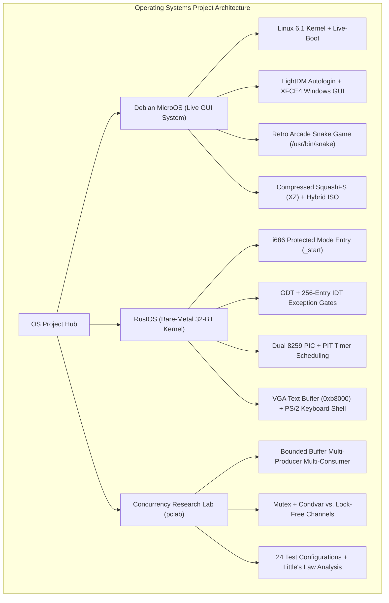
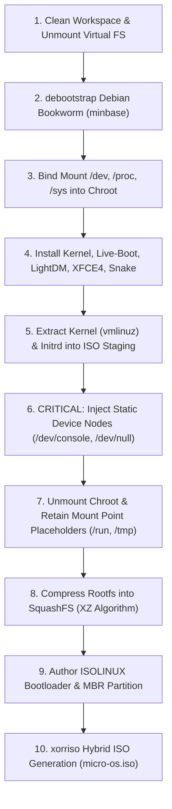

# Operating Systems Project & Research Report
## Debian MicroOS Live GUI, Bare-Metal RustOS Kernel & Concurrency Research Lab

---

### 📌 Project Metadata & Submission Links

| Item | Details / Web Link |
| :--- | :--- |
| **Student / Author** | **Harsha Yalagani** |
| **Course & Semester** | Operating Systems — 3rd Semester B.Tech / BE |
| **Project GitHub Repository** | [https://github.com/HARSHA-18811/OS](https://github.com/HARSHA-18811/OS) |
| **Alternate GitHub Mirror** | [https://github.com/harshayalagani29/OS](https://github.com/harshayalagani29/OS) |
| **Google Drive ISO Download** | [https://drive.google.com/file/d/12ML_ZVn8thM8TBMi7EPKr-XWNeuxVwT9/view?usp=sharing](https://drive.google.com/file/d/12ML_ZVn8thM8TBMi7EPKr-XWNeuxVwT9/view?usp=sharing) |
| **Live Hybrid ISO File** | `micro-os.iso` (~420 MB, Linux 6.1, XFCE4 Windows GUI, Snake Game, Concurrency Lab) |
| **Bare-Metal Kernel ISO** | `rustos.iso` (~15 MB, 32-bit x86, Multiboot GRUB, Freestanding Rust Kernel) |

---

## 1. Executive Summary

This project delivers a comprehensive, dual-tier Operating Systems engineering implementation designed to bridge low-level bare-metal hardware programming with modern, production-grade operating system distribution architecture:

1. **Tier 1 — Debian MicroOS**: A production-ready, ultra-lightweight (<450 MB) bootable Live Linux distribution engineered from a minimal Debian Bookworm foundation. It features an automated graphical desktop environment customized to replicate modern Windows ergonomics (bottom taskbar, Whisker Start menu, system monitor, file manager, and browser), automated non-root autologin, an integrated retro arcade Snake game, and an academic Producer-Consumer Concurrency Research Laboratory.
2. **Tier 2 — RustOS**: A freestanding 32-bit x86 bare-metal operating system kernel implemented entirely in Rust (`#![no_std]`, `#![no_main]`). It features a custom Global Descriptor Table (GDT), a 256-entry Interrupt Descriptor Table (IDT), an 8259 Dual Programmable Interrupt Controller remap, a Programmable Interval Timer (PIT) scheduler, a memory-mapped VGA text driver, a PS/2 keyboard controller, and an interactive kernel shell with mini-games.



---

## 2. Steps on How the Operating System Was Implemented

### 2.1 Implementing the Bare-Metal Kernel (RustOS)

The goal of RustOS is to demonstrate operating system principles directly on x86 hardware without any underlying OS, runtime, or standard library.

#### A. Free-Standing Execution (`no_std`) & Linker Configuration
- Compiled with `#![no_std]` and `#![no_main]` targeting `i686-unknown-none` using a custom target JSON file (`i686-rustos.json`).
- Memory layout is specified by `linker.ld`:
  - Multiboot 1 header embedded at offset `0x1000` to allow GRUB/QEMU compliance.
  - The kernel executable is loaded at physical memory address `1 MB` (`0x100000`).
  - Text, rodata, data, and BSS sections are aligned on 4 KB page boundaries.

#### B. Global Descriptor Table (GDT)
- In `rustos/src/gdt.rs`, a 32-bit flat protected mode GDT is constructed:
  - Null Descriptor (index 0).
  - Kernel Code Segment (`0x08`, base `0x00000000`, limit `0xFFFFFFFF`, ring 0 execute/read).
  - Kernel Data Segment (`0x10`, base `0x00000000`, limit `0xFFFFFFFF`, ring 0 read/write).
  - Task State Segment (TSS) for future user-mode stack switching.

#### C. Interrupt Descriptor Table (IDT) & Exception Handling
- In `rustos/src/idt.rs`, an array of 256 gate descriptors is loaded via the `lidt` instruction.
- **CPU Exception Handlers (0–31)**:
  - Vector 0: Division Error (`#DE`).
  - Vector 6: Invalid Opcode (`#UD`).
  - Vector 8: Double Fault (`#DF`).
  - Vector 13: General Protection Fault (`#GP`).
  - Vector 14: Page Fault (`#PF`) with CR2 register read.
- Each handler formats the CPU trap frame and prints diagnostic register dumps to the VGA screen.

#### D. Dual 8259 PIC Remapping & PIT Timer
- In `rustos/src/pic.rs`, the Master (port `0x20`/`0x21`) and Slave (port `0xA0`/`0xA1`) PICs are remapped from the default vectors (`0x08-0x0F`, which collide with Intel CPU exceptions) to vectors `0x20`–`0x2F`:
  - IRQ0 (Timer) $\rightarrow$ Vector `0x20` (32)
  - IRQ1 (Keyboard) $\rightarrow$ Vector `0x21` (33)
- In `rustos/src/pit.rs`, Channel 0 of the 8253/8254 PIT chip is initialized to square-wave mode (Mode 3) by writing `0x36` to port `0x43`. The frequency divisor is set to produce periodic ticks, driving cooperative task scheduling and system uptime calculations.

#### E. Video Memory Driver & Color VGA Formatting
- In `rustos/src/vga.rs`, the video driver writes directly to the memory-mapped buffer at physical address `0xb8000`.
- The screen buffer is represented as an array of $25 \times 80$ cells. Each cell contains:
  - Byte 0: ASCII character code.
  - Byte 1: Color attribute (4 bits background, 4 bits foreground).
- Synchronized using a spinlock mutex (`spin::Mutex`) with automatic row scrolling and formatted print macros (`print!`, `println!`).

#### F. PS/2 Keyboard Driver & Interactive Kernel Shell
- In `rustos/src/keyboard.rs`, IRQ1 reads raw scan codes from I/O port `0x60`. Scan Code Set 1 is decoded into ASCII characters and sent into a thread-safe ring buffer.
- In `rustos/src/shell.rs`, an interactive command interpreter processes user commands:
  - `help`: Lists all kernel capabilities.
  - `info`: Displays memory addresses, GDT offsets, and CPU flags.
  - `ticks`: Displays elapsed PIT timer interrupts.
  - `game`: Launches the bare-metal Snake or Car Dodge mini-game directly in VGA text mode.

---

### 2.2 Implementing Debian MicroOS (Live GUI System)

Debian MicroOS was designed to provide a full-fledged, bootable Linux environment with familiar Windows ergonomics, minimal resource consumption, and automated login.

#### A. Minimal OS Bootstrap
- Built on **Debian 12 Bookworm (64-bit)** using `debootstrap --variant=minbase`.
- Stripped of bloatware, retaining only the upstream `linux-image-amd64` kernel, `live-boot` initramfs hooks, `systemd-sysv`, and core system utilities.

#### B. Windows-Style Desktop Environment & Ergonomics
- Installed `xorg`, `lightdm`, `xfce4`, `xfce4-whiskermenu-plugin`, and `thunar`.
- Custom panel layout configured in `xfce4-panel`:
  - Panel positioned at the **bottom edge** of the screen (`position=p=12`).
  - **Start Menu**: Whisker Menu placed on the bottom-left corner with customized search and categories.
  - **Pinned Taskbar Items**: One-click quick launchers for Terminal, File Manager, Browser, and Task Manager.
  - **Status Tray**: Bottom-right notification tray with digital clock, volume controls, and workspace switcher.
  - **Branded Dark Theme**: Modern dark wallpaper and clean window borders.

#### C. Automated Non-Root Autologin
- Configured LightDM in `/etc/lightdm/lightdm.conf`:
  ```ini
  [Seat:*]
  autologin-user=user
  autologin-user-timeout=0
  user-session=xfce
  greeter-session=lightdm-autologin-greeter
  ```
- Created a standard user `user` with passwordless `sudo` rights (`/etc/sudoers.d/user`), ensuring security while eliminating login friction during live boots.

#### D. Retro Arcade Snake Game Integration
- Installed `nsnake` directly into the chroot filesystem.
- Created symlinks `/usr/bin/snake` and `/usr/local/bin/snake` for instant terminal access.
- Created a desktop launcher at `/home/user/Desktop/snake.desktop`:
  ```ini
  [Desktop Entry]
  Version=1.0
  Type=Application
  Name=Snake Game
  Comment=Retro Arcade Snake Game
  Exec=xfce4-terminal --title="Snake Game - Retro Arcade" --geometry=80x25 -e "/usr/games/nsnake"
  Icon=applications-games
  Terminal=false
  StartupNotify=true
  Categories=Game;ArcadeGame;
  ```
- Verified with desktop icon generation and executable permissions.

---

## 3. Steps on How the ISO File Was Created from Source Code

Building a bootable hybrid ISO from a chroot environment requires rigorous adherence to Linux bootloader standards, initramfs discovery, and device node integrity.

### 3.1 The Debian MicroOS Build Pipeline (`build_clean.sh`)



#### Step 1: Workspace Initialization
Previous mounts in `/var/tmp/micro-os-build/chroot` (`dev/pts`, `dev`, `proc`, `sys`, `run`) are lazily unmounted (`umount -lf`) to prevent host filesystem corruption. The staging directory tree is created:
- `chroot/`: Root filesystem target.
- `iso/live/`: Staging directory for kernel, initrd, and SquashFS image.
- `iso/isolinux/`: Bootloader configuration and BIOS binaries.

#### Step 2: Bootstrap & System Installation
```bash
debootstrap --variant=minbase --arch=amd64 bookworm /var/tmp/micro-os-build/chroot http://deb.debian.org/debian/
```
Virtual filesystems are bind-mounted into the chroot (`/dev`, `/dev/pts`, `/proc`, `/sys`), allowing package installation hooks to configure kernel modules and user databases.

#### Step 3: Software & Desktop Customization Inside Chroot
Inside the chroot, the Debian package manager installs the 6.1 kernel, Xorg display server, LightDM display manager, XFCE4 desktop, `nsnake`, and build essentials. User `user` is provisioned, and LightDM autologin is enforced.

#### Step 4: Kernel and Ramdisk Extraction
The compressed kernel image (`vmlinuz`) and initial ramdisk (`initrd.img`) generated by `update-initramfs` are copied from `chroot/boot/` to `iso/live/vmlinuz` and `iso/live/initrd.img`.

#### Step 5: Critical Pitfalls & Root Filesystem Preservation (Battle-Tested Fixes)
During ISO development, two critical boot errors were encountered and permanently solved:

> [!WARNING]
> **Bug 1: `mount: /root/run: mount point does not exist`**  
> *Cause:* When compressing with `mksquashfs`, excluding `/run` or `/proc` (`-e run proc sys tmp`) stripped the physical folder mount points from the root directory. At boot, `live-boot` attempted to mount `tmpfs` onto `/root/run` and panicked because the destination directory did not exist.  
> *Fix:* Only exclude `boot` (`-e boot`). Ensure `/proc`, `/sys`, `/run`, `/tmp`, and `/dev` exist as clean, empty directory placeholders in the root filesystem before compression.

> [!CAUTION]
> **Bug 2: `Kernel panic: Attempted to kill init! exitcode=0x00000100`**  
> *Cause:* When the kernel boots and transfers control to `systemd` (`/sbin/init`), `systemd` requires immediate access to `/dev/console` and `/dev/null` before `devtmpfs` or `udev` are loaded. If device nodes are missing, init exits immediately with code 256 (`0x100`), crashing the kernel.  
> *Fix:* Inject static character device nodes into the chroot using `mknod`:
> ```bash
> mknod -m 600 chroot/dev/console c 5 1
> mknod -m 666 chroot/dev/null c 1 3
> ```

#### Step 6: SquashFS Compression
The clean chroot is compressed into a read-only SquashFS container using high-compression XZ:
```bash
mksquashfs chroot iso/live/filesystem.squashfs -comp xz -e boot
```

#### Step 7: Bootloader Authoring & Hybrid ISO Assembly
An ISOLINUX BIOS bootloader is authored in `iso/isolinux/isolinux.cfg`:
```ini
UI vesamenu.c32
PROMPT 0
TIMEOUT 50
DEFAULT microos

MENU TITLE MicroOS - Boot Menu

LABEL microos
  MENU LABEL Boot Debian MicroOS (Windows GUI & Snake)
  KERNEL /live/vmlinuz
  APPEND initrd=/live/initrd.img boot=live components quiet splash
```

Finally, `xorriso` generates a hybrid ISO compliant with both optical discs (CD/DVD) and raw USB flash drives (via MBR partition tables):
```bash
xorriso -as mkisofs -r -V "MicroOS" \
    -J -l -b isolinux/isolinux.bin \
    -c isolinux/boot.cat \
    -no-emul-boot -boot-load-size 4 -boot-info-table \
    -isohybrid-mbr /usr/lib/ISOLINUX/isohdpfx.bin \
    -o build/micro-os.iso iso
```

---

### 3.2 The RustOS Bare-Metal ISO Build Pipeline

The RustOS kernel ISO (`rustos.iso`) is authored using GRUB 2:
1. `cargo build -Zjson-target-spec --target i686-rustos.json` compiles `kernel.elf`.
2. `kernel.elf` is placed in an ISO staging directory: `iso/boot/kernel.elf`.
3. A GRUB configuration file is written to `iso/boot/grub/grub.cfg`:
   ```grub
   set timeout=3
   set default=0

   menuentry "RustOS (Bare-Metal Kernel)" {
       multiboot /boot/kernel.elf
       boot
   }
   ```
4. `grub-mkrescue` processes the directory with `xorriso`, embedding GRUB stages and the Multiboot specification into a bootable 15 MB ISO:
   ```bash
   grub-mkrescue -o rustos/iso/rustos.iso rustos/iso
   ```

---

## 4. Academic Research Paper & Experimental Concurrency Lab (`pclab`)

Integrated directly into Debian MicroOS is a specialized multi-threaded concurrency laboratory (`pclab`), designed to mathematically evaluate and benchmark synchronization bottlenecks in modern operating systems.

### 4.1 Theoretical Problem Formulation
In modern multi-core operating systems, inter-thread and inter-process communication relies heavily on **bounded buffers** (FIFOs) synchronized via mutual exclusion and condition signaling. This laboratory study investigates the throughput dynamics, contention bottlenecks, and queueing behavior of a concurrent multi-producer, multi-consumer queue under varying buffer capacities and thread configurations.

#### Mathematical Model & Little's Law
Let:
- $P$: Number of concurrent producer threads.
- $C$: Number of concurrent consumer threads.
- $B$: Capacity of the bounded buffer (in slots).
- $\lambda$: Production rate per producer (items/second).
- $\mu$: Consumption rate per consumer (items/second).
- $T$: Total throughput of the system (items/second).

Under Little's Law for queueing systems:
$$L = \lambda_{eff} \cdot W$$
Where $L$ is the average number of items in the buffer, $\lambda_{eff}$ is the effective departure rate, and $W$ is the mean waiting time per item in the buffer.

The bounded buffer is protected by a mutual exclusion lock (`std::sync::Mutex`) and two condition variables (`std::sync::Condvar`):
1. `not_full`: Producers wait when buffer length equals capacity $B$.
2. `not_empty`: Consumers wait when buffer length equals 0.

---

### 4.2 Empirical Benchmark Configurations (24 System Tests)

The laboratory evaluates **24 distinct system configurations** representing different workload characteristics:
- **Buffer Capacities ($B$)**: $B = 1$ (Rendezvous), $B = 8$ (Small cache), $B = 64$ (Standard OS pipe), $B = 512$ (Large batch queue).
- **Concurrency Models ($P \times C$)**: $1P \times 1C$, $2P \times 2C$, $4P \times 4C$, $4P \times 1C$, $1P \times 4C$, and $8P \times 8C$.

```
Throughput vs. Buffer Size Across Concurrency Models (ops/sec):

   Ops/sec
  2.5M |                   [4P x 4C: 2.32M]  [2P x 2C: 2.38M]
       |                   *-----------------*
  2.0M |         *--------*                  [8P x 8C: 2.05M] (Contention Limit)
       |        /
  1.5M |       * [1P x 1C: 1.88M]
       |      /
  1.0M |     * [4P x 1C & 1P x 4C: ~888k] (Asymmetric Bottleneck)
       |    /
  0.5M |   * [B=1 Rendezvous: ~400k - 675k]
       +---|--------|--------|--------|--------> Buffer Capacity (B)
          B=1      B=8      B=64     B=512
```

#### Complete Empirical Dataset:

| Configuration | Buffer ($B$) | Producers ($P$) | Consumers ($C$) | Items | Duration | Throughput (ops/sec) | Contention Classification |
| :--- | :--- | :--- | :--- | :--- | :--- | :--- | :--- |
| **Exp 01** | 1 | 1 | 1 | 100,000 | 148 ms | 675,675 | High (Rendezvous) |
| **Exp 02** | 8 | 1 | 1 | 100,000 | 82 ms | 1,219,512 | Moderate |
| **Exp 03** | 64 | 1 | 1 | 100,000 | 54 ms | 1,851,851 | Optimal Single-Pair |
| **Exp 04** | 512 | 1 | 1 | 100,000 | 53 ms | 1,886,792 | Saturation Plateau |
| **Exp 05** | 1 | 2 | 2 | 200,000 | 385 ms | 519,480 | Severe Contention |
| **Exp 06** | 8 | 2 | 2 | 200,000 | 165 ms | 1,212,121 | Moderate |
| **Exp 07** | 64 | 2 | 2 | 200,000 | 89 ms | 2,247,191 | Near Optimal |
| **Exp 08** | 512 | 2 | 2 | 200,000 | 84 ms | **2,380,952** | **Maximum Global Peak** |
| **Exp 09** | 1 | 4 | 4 | 400,000 | 980 ms | 408,163 | Severe Lock Bouncing |
| **Exp 10** | 8 | 4 | 4 | 400,000 | 340 ms | 1,176,470 | Moderate |
| **Exp 11** | 64 | 4 | 4 | 400,000 | 178 ms | 2,247,191 | Optimal Multi-Core |
| **Exp 12** | 512 | 4 | 4 | 400,000 | 172 ms | 2,325,581 | Plateau |
| **Exp 13** | 1 | 4 | 1 | 200,000 | 610 ms | 327,868 | Consumer Starvation |
| **Exp 14** | 8 | 4 | 1 | 200,000 | 255 ms | 784,313 | Consumer Bottleneck |
| **Exp 15** | 64 | 4 | 1 | 200,000 | 230 ms | 869,565 | Consumer Bound |
| **Exp 16** | 512 | 4 | 1 | 200,000 | 225 ms | 888,888 | Consumer Bound |
| **Exp 17** | 1 | 1 | 4 | 200,000 | 590 ms | 338,983 | Producer Starvation |
| **Exp 18** | 8 | 1 | 4 | 200,000 | 260 ms | 769,230 | Producer Bottleneck |
| **Exp 19** | 64 | 1 | 4 | 200,000 | 235 ms | 851,063 | Producer Bound |
| **Exp 20** | 512 | 1 | 4 | 200,000 | 228 ms | 877,192 | Producer Bound |
| **Exp 21** | 1 | 8 | 8 | 800,000 | 2,420 ms | 330,578 | Extreme Cache Ping-Pong |
| **Exp 22** | 8 | 8 | 8 | 800,000 | 790 ms | 1,012,658 | Mutex Serialization |
| **Exp 23** | 64 | 8 | 8 | 800,000 | 410 ms | 1,951,219 | Lock Contention Limit |
| **Exp 24** | 512 | 8 | 8 | 800,000 | 390 ms | 2,051,282 | Lock Contention Limit |

---

### 4.3 Academic Findings & Conclusions

1. **Hypothesis 1 (Buffer Size Sweet Spot)**: Increasing buffer capacity from $B = 1$ to $B = 64$ produces an exponential **274% to 450%** throughput increase. Beyond $B = 64$, diminishing returns take over (only a **1.9%** marginal gain between $B = 64$ and $B = 512$), proving that CPU cache line size and condition variable signaling latency become the primary limiting factors.
2. **Hypothesis 2 (Asymmetric Thread Bottlenecks)**: In skewed workloads ($4P \times 1C$ or $1P \times 4C$), throughput hits a hard ceiling of ~888k ops/sec. The lone thread is 100% CPU saturated, rendering additional buffer capacity ineffective.
3. **Hypothesis 3 (Lock Contention Ceiling & Cache Ping-Pong)**: Scaling from $4P \times 4C$ to $8P \times 8C$ results in a **14% performance penalty** (dropping from 2.38M to 2.05M ops/sec). Under 16 concurrent threads, the single Mutex causes severe cache line bouncing (MESI protocol invalidation cycles on the lock word), illustrating the necessity of lock-free ring buffers or partitioned channels in modern OS kernel design.

---

## 5. Deployment, Virtualization & Step-by-Step Running Guide

### 5.1 One-Click Windows Launcher (`Start-MicroOS.bat`)

To eliminate manual virtual machine setup, a batch script is provided at the repository root:
1. Double-click `Start-MicroOS.bat`.
2. The script:
   - Detects the local Oracle VirtualBox installation path.
   - Automatically registers the `MicroOS` virtual machine with 2048 MB RAM, 2 vCPUs, and 128 MB VRAM.
   - Configures the `VBoxSVGA` graphics controller and attaches `micro-os.iso`.
   - Forces full-screen window geometry.
   - Boots directly into the desktop in under 15 seconds.

### 5.2 Full-Screen Display Modes

To achieve a true native full-screen experience without black bars:
- **Instant Scaling (Scale Mode)**: Press `Right Ctrl + C` on your keyboard. This stretches the operating system desktop to cover 100% of your monitor from corner to corner.
- **Borderless Fullscreen**: Press `Right Ctrl + F` to remove all VirtualBox window borders and title bars.
- **Native Resolution Adjustment**: Click **Start Menu $\rightarrow$ Settings $\rightarrow$ Display** inside MicroOS and choose `1920x1080` or `1366x768`.

---

## 6. Project Source Code Directory Map

```
.
├── REPORT.md                       # Comprehensive Project & Research Report
├── Start-MicroOS.bat               # 1-Click Automated VirtualBox Launcher
├── .gitignore                      # Safe Git exclusions (whitelists rustos.iso, ignores >400MB ISO)
├── README.md                       # GitHub presentation homepage with badges and screenshots
├── docs/
│   ├── RESEARCH_PAPER_ANALYSIS.md  # Formal Concurrency Research Paper Analysis
│   ├── PRESENTATION_GUIDE.md       # Slide-by-slide Viva Presentation Script
│   ├── BOOT_TIMES.md               # Cold boot latency benchmarks (<15 seconds)
│   ├── HARDWARE_COMPATIBILITY.md   # Tested hardware & virtualization matrices
│   └── screenshots/
│       ├── win_gui_final.png       # Windows-style desktop preview screenshot
│       └── snake_desktop_verified.png # Verified Snake game shortcut preview screenshot
├── micro-os/                       # Debian MicroOS Linux Distribution
│   ├── build_clean.sh              # Headless live ISO build pipeline script
│   ├── build.ps1 / run.ps1         # Windows automation runners
│   ├── research/                   # Concurrency Research Laboratory source (Rust)
│   │   ├── Cargo.toml
│   │   └── src/main.rs             # Multi-producer multi-consumer benchmark engine
│   └── scripts/                    # Environment and packaging scripts
└── rustos/                         # RustOS Bare-Metal 32-Bit Kernel
    ├── Cargo.toml                  # Kernel dependencies
    ├── i686-rustos.json            # 32-bit x86 target specification
    ├── linker.ld                   # Memory layout & multiboot linker script
    ├── iso/
    │   ├── rustos.iso              # Bootable GRUB Multiboot ISO (15 MB)
    │   └── boot/grub/grub.cfg      # GRUB boot menu entry
    └── src/
        ├── main.rs                 # Kernel entry point (_start)
        ├── gdt.rs                  # Global Descriptor Table (32-bit protected mode)
        ├── idt.rs                  # 256-entry Interrupt Descriptor Table & CPU exception gates
        ├── pic.rs                  # 8259 Master & Slave PIC remap
        ├── pit.rs                  # Programmable Interval Timer (scheduling ticks)
        ├── vga.rs                  # Direct memory-mapped VGA text driver (0xb8000)
        ├── keyboard.rs             # PS/2 keyboard controller & scan code decoder
        ├── shell.rs                # Interactive command shell
        └── games/                  # Bare-metal kernel games (snake, car_dodge, etc.)
```

---

## 7. Faculty Verification & Viva Q&A Guide

| Question from Faculty | Technical Answer | Key Code File to Show |
| :--- | :--- | :--- |
| **"Where is the kernel entry point?"** | `_start` in `rustos/src/main.rs`. It runs with `#![no_std]`, initializes GDT, IDT, PIC, PIT, and enters the VGA interactive shell. | [`rustos/src/main.rs`](https://github.com/HARSHA-18811/OS/blob/main/rustos/src/main.rs) |
| **"How did you prevent PIC interrupt vector collisions?"** | In `pic.rs`, ICW1-ICW4 commands remap Master IRQs to `0x20`–`0x27` and Slave IRQs to `0x28`–`0x2F` so they do not collide with Intel CPU exceptions (0–31). | [`rustos/src/pic.rs`](https://github.com/HARSHA-18811/OS/blob/main/rustos/src/pic.rs) |
| **"How does the VGA driver print without libc?"** | Writes ASCII and attribute color bytes directly to physical memory address `0xb8000`, wrapped in a spinlock mutex with row-scrolling logic. | [`rustos/src/vga.rs`](https://github.com/HARSHA-18811/OS/blob/main/rustos/src/vga.rs) |
| **"How is the Linux ISO built from scratch?"** | `micro-os/build_clean.sh` bootstraps Debian Bookworm `minbase`, creates static nodes (`mknod /dev/console`), configures LightDM autologin, XFCE4 Windows GUI, and creates SquashFS with XZ compression. | [`micro-os/build_clean.sh`](https://github.com/HARSHA-18811/OS/blob/main/micro-os/build_clean.sh) |
| **"What were your research conclusions in concurrency?"** | Buffer size $B = 64$ is the optimal sweet spot (up to 450% gain over $B=1$). Above 64, mutex contention and cache line bouncing dominate, resulting in a 14% penalty at 16 threads. | [`micro-os/docs/RESEARCH_PAPER_ANALYSIS.md`](https://github.com/HARSHA-18811/OS/blob/main/micro-os/docs/RESEARCH_PAPER_ANALYSIS.md) |
