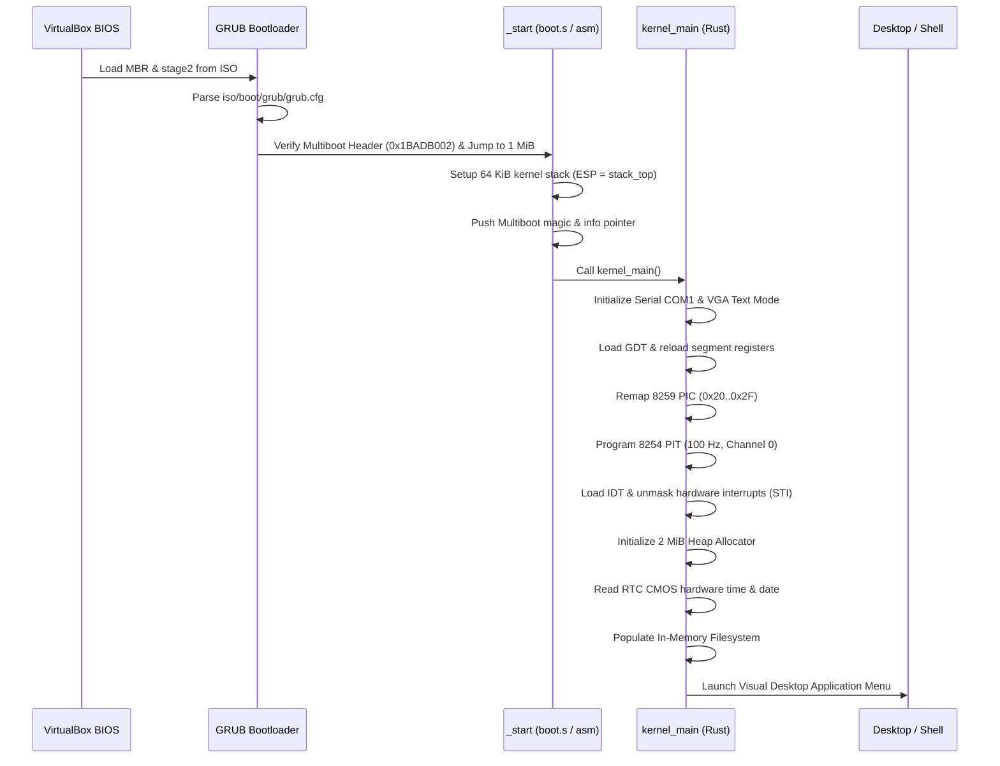

# RustOS Architecture & Technical Specification

This document provides an in-depth technical explanation of the internal architecture, hardware abstraction layer, memory organization, and subsystem design of RustOS.

---

## 1. High-Level System Architecture

RustOS is structured as a modular monolithic educational operating system built in bare-metal Rust (`no_std`, `no_main`).

```
+-----------------------------------------------------------------------------------+
|                                  APPLICATIONS                                     |
|  Shell (27 cmds)  |  Vi Editor  |  Snake  |  Snakes & Ladders  |  Car Dodge  | Lab |
+-----------------------------------------------------------------------------------+
|                               SUBSYSTEM LAYER                                     |
|  Desktop Menu     |  Status Bar |  In-Memory VFS (32 files)  |  Task Scheduler    |
+-----------------------------------------------------------------------------------+
|                           MEMORY & ALLOCATOR LAYER                                |
|  2 MiB Linked-List Allocator with Block Coalescing  |  Spinlock Synchronization   |
+-----------------------------------------------------------------------------------+
|                        HARDWARE ABSTRACTION LAYER (HAL)                           |
|  VGA (80x25)  |  Serial COM1  |  GDT  |  IDT  |  8259 PIC  |  8254 PIT  |  CMOS   |
+-----------------------------------------------------------------------------------+
|                                  VIRTUAL HARDWARE                                 |
|                         Oracle VirtualBox 7.x (i686 / BIOS)                       |
+-----------------------------------------------------------------------------------+
```

---

## 2. Boot Flow & Execution Pipeline



### Multiboot 1 Header
Located in section `.multiboot_header` within the first 8 KiB of the ELF binary:
- **Magic**: `0x1BADB002`
- **Flags**: `0x00000003` (align modules on 4K boundaries + provide memory map)
- **Checksum**: `0xE4524FFB` (`-(0x1BADB002 + 0x00000003) = 0xE4524FFB`)
- Verification: `(magic + flags + checksum) == 0 (mod 2^32)`

---

## 3. Physical Memory Map & Layout

RustOS is linked via `linker.ld` to execute directly at physical address `1 MiB`:

| Physical Address Range | Region Size | Purpose | Attributes |
|:---|:---|:---|:---|
| `0x00000000 - 0x000003FF` | 1 KiB | Real Mode Interrupt Vector Table (IVT) | Reserved |
| `0x00000400 - 0x000004FF` | 256 B | BIOS Data Area (BDA) | Reserved |
| `0x000A0000 - 0x000B7FFF` | 96 KiB | VGA Graphic Framebuffers | Reserved |
| `0x000B8000 - 0x000B8FA0` | 4 KiB | VGA Text Mode Buffer (80x25 characters) | MMIO / Volatile |
| `0x000C0000 - 0x000FFFFF` | 256 KiB | Video BIOS & Motherboard BIOS ROM | Read-Only |
| `0x00100000 - ...` | ~80 KiB | Kernel `.text`, `.rodata`, `.data` sections | Executable / Data |
| `... - ...` | 64 KiB | Kernel Execution Stack (`stack_bottom..stack_top`) | Read / Write |
| `... - ...` | 2 MiB | Heap Region (`HEAP_MEMORY` BSS static buffer) | Dynamic Allocations |
| `0x00400000 - 0x08000000` | ~120 MiB | Extended Conventional RAM (VirtualBox 128 MB VM) | Available |

---

## 4. Hardware Abstraction Layer (HAL)

### 4.1 Global Descriptor Table (GDT)
- Flat 4 GB 32-bit Protected Mode segmentation model:
  - **Selector `0x00`**: Null Descriptor (mandatory by x86 architecture).
  - **Selector `0x08`**: Kernel Code Segment (Base: `0x0`, Limit: `4 GB`, Exec/Read, Ring 0, 32-bit).
  - **Selector `0x10`**: Kernel Data Segment (Base: `0x0`, Limit: `4 GB`, Read/Write, Ring 0, 32-bit).
- Loaded via `lgdt` instruction followed by a far jump (`jmp 0x08:reload_cs`) to flush the CPU instruction prefetch queue and reload `DS`, `ES`, `FS`, `GS`, `SS` with `0x10`.

### 4.2 8259 Programmable Interrupt Controller (PIC)
- IBM PC standard master and slave PICs:
  - Master PIC command port: `0x20`, data port: `0x21`
  - Slave PIC command port: `0xA0`, data port: `0xA1`
- Remapped from default BIOS vectors (`0x08..0x0F` which clash with CPU exceptions) to vectors `0x20..0x27` (Master) and `0x28..0x2F` (Slave).
- Initialization uses standard 4-step ICW (Initialization Command Words) sequence with `io_wait()` bus delays.
- Hardware interrupts unmasked: IRQ0 (Timer) and IRQ1 (Keyboard).

### 4.3 8254 Programmable Interval Timer (PIT)
- Uses Channel 0 (port `0x40`) with Mode/Command port `0x43`.
- Programmed in Mode 3 (Square Wave Generator).
- Base oscillator frequency: `1,193,182 Hz`.
- Frequency set to **100 Hz** (`10 ms` per tick):
  $$\text{Divisor} = \frac{1,193,182}{100} = 11,931 \ (\text{0x2E9B})$$
- Tick counter maintained via atomic integer `TICKS: AtomicU32`. Provides `sleep_ms(ms)` and `uptime_hms()`.

### 4.4 Interrupt Descriptor Table (IDT)
- 256 interrupt gates configured with DPL = 0 (Ring 0) and 32-bit Interrupt Gate type (`0x8E`).
- 48 assembly ISR stubs (`isr_stub_0` to `isr_stub_47`):
  - Stubs `0..31`: CPU Exceptions (Divide Error, Page Fault, General Protection Fault, etc.). Handlers dump CPU register state, print descriptive error in red, and halt the CPU.
  - Stub `32` (`IRQ0`): Dispatched to `pit::on_timer_tick()`.
  - Stub `33` (`IRQ1`): Dispatched to `keyboard::on_keyboard_interrupt()`.
- Both master and slave PICs receive EOI (`0x20`) on completion.

### 4.5 PS/2 Keyboard Driver
- Interrupt-driven via IRQ1, reading scancodes from port `0x60`.
- Maintains a 128-byte circular ring buffer.
- Tracks modifier states (Left/Right Shift, Caps Lock).
- Extended scancode decoding (`0xE0` prefix):
  - Up Arrow: `0x48`
  - Down Arrow: `0x50`
  - Left Arrow: `0x4B`
  - Right Arrow: `0x4D`
- Implements non-blocking `try_get_key() -> Option<Key>` and blocking `get_key() -> Key`.

### 4.6 CMOS Real-Time Clock (RTC)
- Accesses CMOS registers via address port `0x70` and data port `0x71`.
- Update-In-Progress (`UIP`) polling on Status Register A bit 7 prevents reading torn values.
- Performs double-read verification for rollover consistency.
- Automatically detects and decodes BCD vs Binary mode (Status Register B bit 2).
- Normalizes 12-hour AM/PM format to 24-hour military time (Status Register B bit 1).
- Calculates full 4-digit Gregorian year and computes day of week via Sakamoto's congruence algorithm.

---

## 5. Dynamic Memory Allocator

RustOS implements a custom Doubly-Linked Free-List Allocator:
- **Storage**: Dedicated 2 MiB static BSS buffer (`HEAP_MEMORY`).
- **Alignment**: Enforces 16-byte alignment across all block headers and payloads.
- **Header Structure**:
  ```rust
  #[repr(C, align(16))]
  struct BlockHeader {
      size: usize,
      is_free: bool,
      prev: *mut BlockHeader,
      next: *mut BlockHeader,
  }
  ```
- **Coalescing**: When memory is deallocated, adjacent free blocks are immediately merged in $O(1)$ time, eliminating external fragmentation.
- **Thread Safety**: Synchronized via custom `Spinlock<Heap>`.
- Enables full standard `alloc` crate capabilities: `alloc::vec::Vec`, `alloc::string::String`, `alloc::boxed::Box`, `alloc::format!`.

---

## 6. In-Memory Virtual File System (VFS)

- Static table holding up to 32 active files, up to 2048 bytes each.
- Metadata per entry:
  - `name`: Max 24 UTF-8 characters.
  - `readonly`: Boolean flag (true = `r--` [mode 4], false = `rw-` [mode 6]).
  - `size`: Length of file payload in bytes.
  - `data`: 2048-byte fixed buffer.
- Operations: `create_file`, `write_file` (with append support), `read_file`, `delete_file`, `rename_file`, `copy_file`, `chmod`, `list_files`.
- Pre-populated at boot with `readme.txt`, `notes.txt`, `todo.txt`, and read-only `about.txt`.
