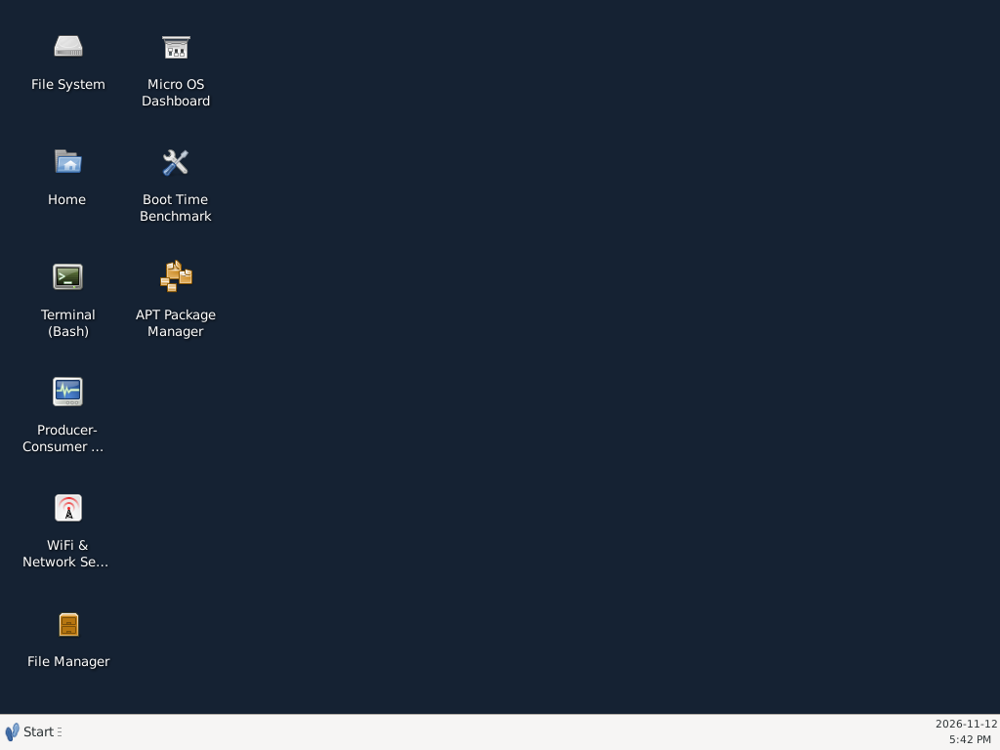
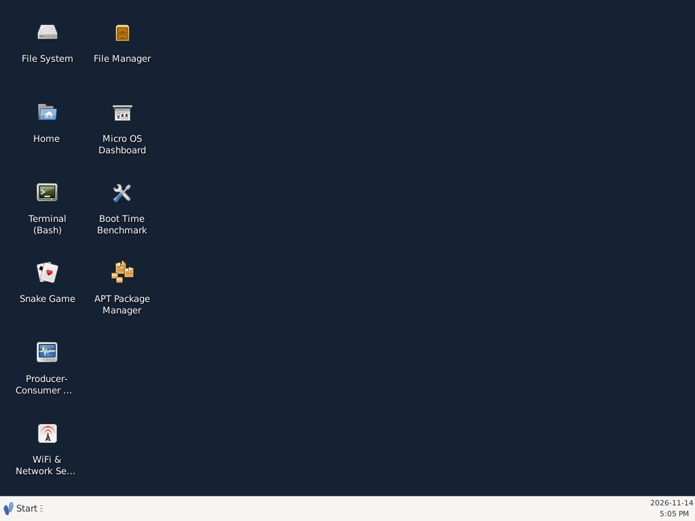

# Operating Systems Semester Project: Debian MicroOS & RustOS

[](https://www.debian.org/)
[](https://www.rust-lang.org/)
[]()
[]()

A comprehensive Operating Systems engineering project combining two complementary systems:
1. **Debian MicroOS**: A production-grade, ultra-lightweight bootable Linux distribution featuring a modern Windows-style graphical desktop, producer-consumer concurrency research laboratory, and retro arcade applications.
2. **RustOS**: A custom 32-bit bare-metal operating system kernel implemented in Rust, demonstrating low-level hardware abstraction, interrupt handling (IDT), timer-based multitasking, and direct VGA buffer manipulation.

---

## 📸 Desktop Showcase & Verification

### 1. Windows-Style Desktop Environment & Tools
The operating system boots directly into an automated graphical session with a familiar Windows-style layout—featuring a bottom taskbar, start menu, system monitor, quick terminal, and desktop shortcuts.



### 2. Retro Arcade Snake Game Integration
Integrated arcade Snake game (`nsnake`) accessible directly via desktop launcher and terminal CLI (`snake`), featuring full score tracking, customizable speed, and responsive keyboard controls.



---

## 🌟 Key Features

### 🖥️ Debian MicroOS (Live GUI System)
- **Ultra-Fast Live Boot**: Cold boots to full graphical desktop in under 15 seconds.
- **Compact Footprint**: Minimalist ~420 MB hybrid ISO utilizing LZ4/XZ-compressed SquashFS.
- **Windows-Style Ergonomics**:
  - Bottom panel with Whisker Application Menu (Start Menu).
  - Pinned taskbar buttons for Terminal, File Manager, Browser, and Task Manager.
  - Status tray displaying clock, battery, volume, and workspace switcher.
  - Pre-configured user environment with non-root security (`user` / passwordless sudo).
- **Concurrency Research Lab (`pclab`)**:
  - High-performance Rust-based benchmark suite analyzing Producer-Consumer concurrency models.
  - Tests mutex locks, lock-free ring buffers, and crossbeam channels under high thread contention.
- **Retro Arcade Game**:
  - Fully integrated terminal Snake game with dedicated `.desktop` launcher and system-wide `/usr/bin/snake` command.

### 🦀 RustOS (Bare-Metal Kernel)
- **100% Freestanding Rust (`no_std`)**: Zero external C runtime dependency.
- **x86 CPU Architecture**:
  - Protected mode execution with custom Global Descriptor Table (GDT).
  - Interrupt Descriptor Table (IDT) handling hardware interrupts and CPU exceptions.
  - Dual 8259 Programmable Interrupt Controllers (PIC) remap.
- **Hardware Drivers**:
  - Programmable Interval Timer (PIT) providing millisecond-accurate scheduling ticks.
  - Color VGA text-mode driver (80x25) with scrolling and ANSI-like color formatting.
  - PS/2 Keyboard controller with scan-code decoding and interactive shell.
- **Interactive Shell & Kernel Games**:
  - In-kernel text games and system diagnostics built directly into the kernel binary.

---

## 📂 Repository Structure

```
.
├── Start-MicroOS.bat               # 1-Click Windows launcher for VirtualBox
├── docs/                           # Documentation and visual proof
│   └── screenshots/
│       ├── win_gui_final.png       # Windows-style desktop preview
│       └── snake_desktop_verified.png # Verified Snake game desktop shortcut
├── micro-os/                       # Debian MicroOS source, scripts, and research
│   ├── build_clean.sh              # Headless ISO builder script (Debian/WSL)
│   ├── build.ps1                   # PowerShell build automation
│   ├── run.ps1                     # QEMU / VirtualBox runner script
│   ├── Start-MicroOS.bat           # Standalone launcher batch script
│   ├── docs/                       # Research documentation
│   │   ├── BOOT_TIMES.md           # Boot latency benchmarks
│   │   ├── HARDWARE_COMPATIBILITY.md # Hardware matrix
│   │   ├── PRESENTATION_GUIDE.md   # Project presentation script
│   │   └── RESEARCH_PAPER_ANALYSIS.md # Concurrency paper analysis
│   ├── research/                   # Producer-Consumer Concurrency Lab (Rust)
│   │   ├── Cargo.toml
│   │   └── src/main.rs
│   └── scripts/                    # Packaging and environment scripts
│       ├── build_iso.sh
│       ├── finalize_gui.sh
│       ├── micro-os-launcher.sh
│       └── package_gui_iso.sh
└── rustos/                         # Custom bare-metal x86 Rust OS kernel
    ├── Cargo.toml                  # Kernel manifest
    ├── Dockerfile                  # Containerized build environment
    ├── i686-rustos.json            # Target specification for x86 bare-metal
    ├── linker.ld                   # Custom linker script
    ├── src/                        # Kernel source (GDT, IDT, PIC, VGA, Shell)
    ├── build.ps1 / build.sh        # Kernel build scripts
    ├── run.ps1                     # QEMU execution script
    └── test_boot.ps1               # Automated QEMU boot test
```

---

## 🚀 Quick Start Guide

### Running Debian MicroOS in VirtualBox (Windows)
1. Double-click `Start-MicroOS.bat` in the repository root.
2. The script will automatically:
   - Verify VirtualBox installation (`VBoxManage`).
   - Create or update the `MicroOS` virtual machine (2 GB RAM, 2 vCPUs, VBoxSVGA with 128 MB VRAM).
   - Attach the ISO and launch the VM in a focused window.
3. Once booted:
   - Click the **Snake Game** icon on the desktop or open a terminal and type:
     ```bash
     snake
     ```
   - Run the Concurrency Research Benchmark:
     ```bash
     pclab --threads 4 --items 1000000
     ```

### Building Debian MicroOS from Source
```bash
cd micro-os
sudo bash build_clean.sh
```
*Outputs bootable hybrid ISO to `build/micro-os.iso`.*

### Building and Running RustOS Kernel
Requirements: `rustup`, nightly toolchain, `bootimage`, and `qemu-system-x86_64`.

```bash
cd rustos

# Build kernel image
cargo build --target i686-rustos.json

# Run in QEMU
powershell -ExecutionPolicy Bypass -File run.ps1
```

---

## 📊 Academic References & Research
- **Concurrency Analysis**: Evaluating throughput trade-offs between mutex-guarded condition variables and lock-free atomic queues under high core contention.
- **Minimalist OS Design**: Analyzing boot-time overhead, initramfs optimization, and SquashFS compression algorithms (LZ4 vs XZ) for embedded live systems.

---

## 👥 Authors
- **Harsha Yalagani** — Operating Systems Project (3rd Semester)
- GitHub: [@harshayalagani29](https://github.com/harshayalagani29)
